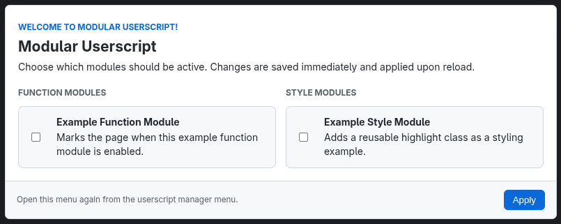

# Modular Userscript Template

> A small template for building userscripts from independent, toggleable modules.

The template bundles independent modules into one configurable userscript using bundlemonkey. Enable only what you want; settings persist through the userscript manager and changes take effect after reload.



## What It Does

Every module is disabled by default and can be toggled from the configuration dialog.

## Install

Build `dist/modular-userscript.user.js` locally and import it into your preferred userscript manager. Before installing, customize the metadata and `match` pattern in `src/modular-userscript/index.user.js`.

## Development

```bash
npm install
npm run build
```

The production userscript is written to `dist/`.

For iterative development:

```bash
npm run watch
```

BundleMonkey performs the bundling. The build wrapper also handles the workspace path safely and generates the module registry and dialog assets automatically.

## Project Shape

```text
src/modular-userscript/
├── index.user.js                 # runtime, settings, and dialog coordinator
├── dialog.html                   # dialog markup
├── dialog.css                    # dialog styling
└── modules/
  ├── example-function.js
  └── example-style.js
```

## Add A Module

Create one file in `src/modular-userscript/modules/` and export a module object:

```js
export default {
  key: 'myModuleEnabled',
  type: 'function', // 'function' or 'style'
  title: 'My Module',
  description: 'What this module does.',
  enabledByDefault: false,
  run({ document, window, location }) {
    // Module behavior
  },
};
```

That is all. The build automatically discovers every `.js` file in the modules folder, adds it to the toolbox dialog, persists its setting, and runs it when enabled.

Use the supplied context for page checks and module behavior. Every JavaScript file in the modules folder is discovered automatically.

## Runtime Notes

- Settings use `GM_getValue`/`GM_setValue` or modern `GM.getValue`/`GM.setValue` APIs.
- `localStorage` is used as a fallback when no GM storage API is available.
- The userscript menu contains **Modular Userscript: Open config**.
- The configuration dialog opens automatically on first install and after a version change.

## License

[GPL-3.0](LICENSE)
